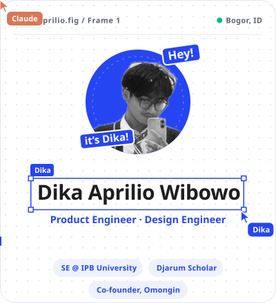
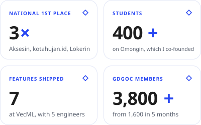
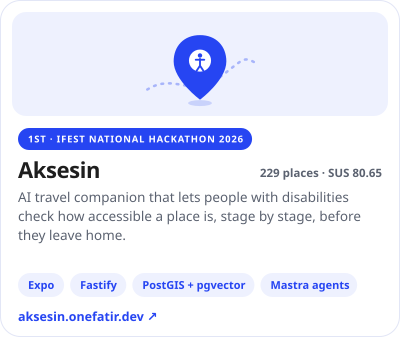
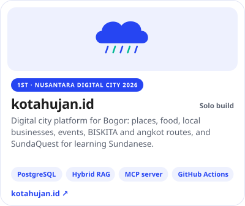
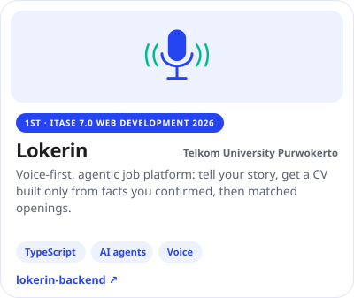
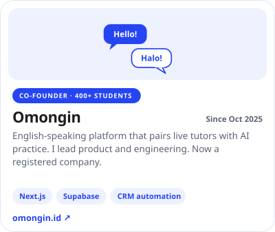
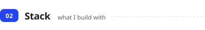
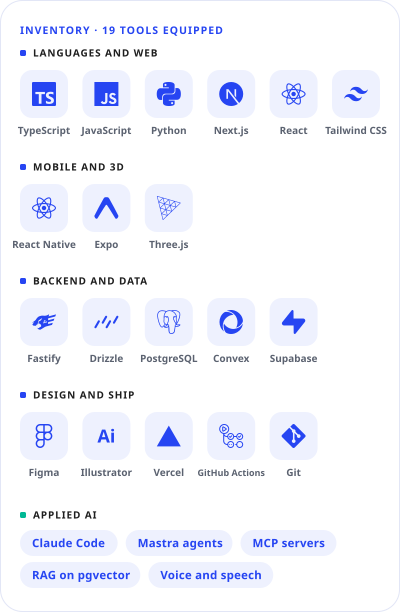
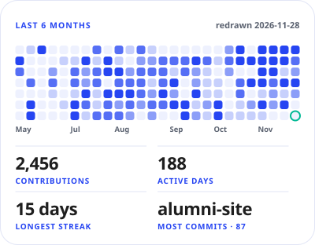
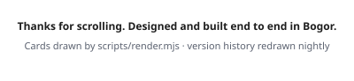

<!--
  Profile README for @dikaprilio, in the same brand as the feed:
  Manrope only, #2645F2 on white, a design-file canvas.
  Every card is drawn by scripts/render.mjs from scripts/data/profile.mjs.
  Edit the data, then run: node scripts/render.mjs
-->

<picture><source media="(prefers-color-scheme: dark) and (min-width: 768px)" srcset="assets/hero-dark.svg" /><source media="(prefers-color-scheme: light) and (min-width: 768px)" srcset="assets/hero-light.svg" /><source media="(prefers-color-scheme: dark)" srcset="assets/hero-dark-mobile.svg" /></picture>

<picture><source media="(prefers-color-scheme: dark) and (min-width: 768px)" srcset="assets/stats-dark.svg" /><source media="(prefers-color-scheme: light) and (min-width: 768px)" srcset="assets/stats-light.svg" /><source media="(prefers-color-scheme: dark)" srcset="assets/stats-dark-mobile.svg" /></picture>

<picture><source media="(prefers-color-scheme: dark) and (min-width: 768px)" srcset="assets/header-work-dark.svg" /><source media="(prefers-color-scheme: light) and (min-width: 768px)" srcset="assets/header-work-light.svg" /><source media="(prefers-color-scheme: dark)" srcset="assets/header-work-dark-mobile.svg" /></picture>

<a href="https://aksesin.onefatir.dev"><picture><source media="(prefers-color-scheme: dark) and (min-width: 768px)" srcset="assets/work-aksesin-dark.svg" /><source media="(prefers-color-scheme: light) and (min-width: 768px)" srcset="assets/work-aksesin-light.svg" /><source media="(prefers-color-scheme: dark)" srcset="assets/work-aksesin-dark-mobile.svg" /></picture></a>

<a href="https://kotahujan.id"><picture><source media="(prefers-color-scheme: dark) and (min-width: 768px)" srcset="assets/work-kotahujan-dark.svg" /><source media="(prefers-color-scheme: light) and (min-width: 768px)" srcset="assets/work-kotahujan-light.svg" /><source media="(prefers-color-scheme: dark)" srcset="assets/work-kotahujan-dark-mobile.svg" /></picture></a>

<a href="https://github.com/dikaprilio/lokerin-backend"><picture><source media="(prefers-color-scheme: dark) and (min-width: 768px)" srcset="assets/work-lokerin-dark.svg" /><source media="(prefers-color-scheme: light) and (min-width: 768px)" srcset="assets/work-lokerin-light.svg" /><source media="(prefers-color-scheme: dark)" srcset="assets/work-lokerin-dark-mobile.svg" /></picture></a>

<a href="https://omongin.id"><picture><source media="(prefers-color-scheme: dark) and (min-width: 768px)" srcset="assets/work-omongin-dark.svg" /><source media="(prefers-color-scheme: light) and (min-width: 768px)" srcset="assets/work-omongin-light.svg" /><source media="(prefers-color-scheme: dark)" srcset="assets/work-omongin-dark-mobile.svg" /></picture></a>

<picture><source media="(prefers-color-scheme: dark) and (min-width: 768px)" srcset="assets/header-stack-dark.svg" /><source media="(prefers-color-scheme: light) and (min-width: 768px)" srcset="assets/header-stack-light.svg" /><source media="(prefers-color-scheme: dark)" srcset="assets/header-stack-dark-mobile.svg" /></picture>

<picture><source media="(prefers-color-scheme: dark) and (min-width: 768px)" srcset="assets/stack-dark.svg" /><source media="(prefers-color-scheme: light) and (min-width: 768px)" srcset="assets/stack-light.svg" /><source media="(prefers-color-scheme: dark)" srcset="assets/stack-dark-mobile.svg" /></picture>

<picture><source media="(prefers-color-scheme: dark) and (min-width: 768px)" srcset="assets/header-activity-dark.svg" /><source media="(prefers-color-scheme: light) and (min-width: 768px)" srcset="assets/header-activity-light.svg" /><source media="(prefers-color-scheme: dark)" srcset="assets/header-activity-dark-mobile.svg" /></picture>

<a href="https://github.com/dikaprilio"><picture><source media="(prefers-color-scheme: dark) and (min-width: 768px)" srcset="https://raw.githubusercontent.com/dikaprilio/dikaprilio/output/activity-dark.svg" /><source media="(prefers-color-scheme: light) and (min-width: 768px)" srcset="https://raw.githubusercontent.com/dikaprilio/dikaprilio/output/activity-light.svg" /><source media="(prefers-color-scheme: dark)" srcset="https://raw.githubusercontent.com/dikaprilio/dikaprilio/output/activity-dark-mobile.svg" /></picture></a>

<picture><source media="(prefers-color-scheme: dark) and (min-width: 768px)" srcset="assets/header-comms-dark.svg" /><source media="(prefers-color-scheme: light) and (min-width: 768px)" srcset="assets/header-comms-light.svg" /><source media="(prefers-color-scheme: dark)" srcset="assets/header-comms-dark-mobile.svg" /></picture>

<a href="https://linkedin.com/in/dikaaprilio"><picture><source media="(prefers-color-scheme: dark)" srcset="assets/comm-linkedin-dark.svg" /></picture></a>
<a href="https://instagram.com/dikaaprilio.w"><picture><source media="(prefers-color-scheme: dark)" srcset="assets/comm-instagram-dark.svg" /></picture></a>
<a href="mailto:apridika07@gmail.com"><picture><source media="(prefers-color-scheme: dark)" srcset="assets/comm-gmail-dark.svg" /></picture></a>

<picture><source media="(prefers-color-scheme: dark) and (min-width: 768px)" srcset="assets/footer-dark.svg" /><source media="(prefers-color-scheme: light) and (min-width: 768px)" srcset="assets/footer-light.svg" /><source media="(prefers-color-scheme: dark)" srcset="assets/footer-dark-mobile.svg" /></picture>
